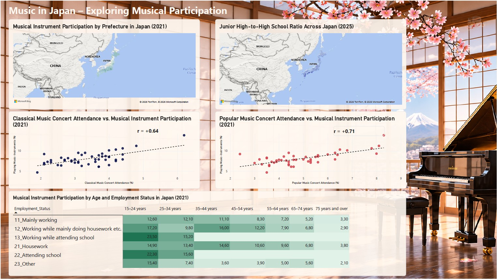

# Music in Japan – Exploring Musical Participation

A data analytics project exploring regional differences, musical participation, demographic patterns, and the school landscape across Japan.

## Power BI Dashboard

The dashboard was created using Power BI Desktop and includes five visualizations covering four research questions.

Download the `.pbix` file from this repository to explore the interactive report in Power BI Desktop.

## Case Study

The complete project documentation includes the research questions, data preparation, SQL analysis, key findings, and conclusions.

[Read the full Case Study (PDF)](Music_in_Japan_Case_Study.pdf)

## SQL Analysis

The SQL queries used to analyze the research questions are available below:

- [RQ1 – Regional perspective](SQL/RQ1_Regional.sql)
- [RQ2 – Musical perspective](SQL/RQ2_Musical.sql)
- [RQ3 – People perspective](SQL/RQ3_People.sql)
- [RQ4 – School Landscape](SQL/RQ4_Schools.sql)
